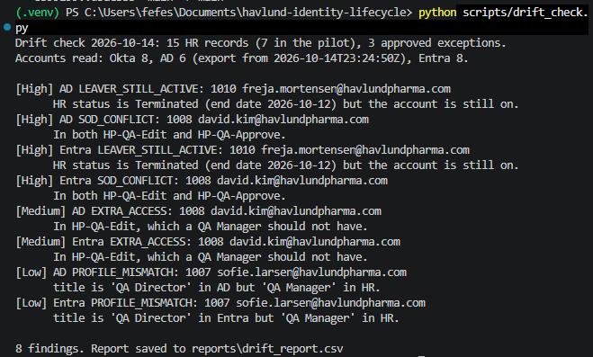
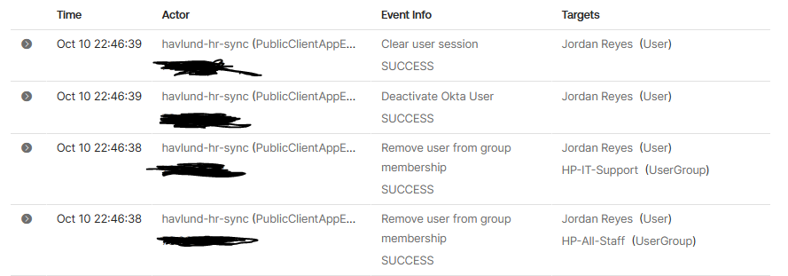
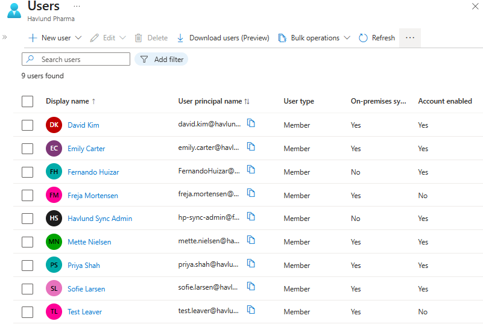
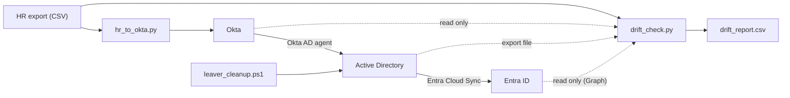

# Havlund Pharma HR-driven identity lifecycle

New hires wait days for access, people who leave keep it too long, and nobody can easily show who has access to what. That's the problem this lab fixes.

I built a setup where HR changes flow automatically into Okta, Active Directory and Entra ID. A second script checks all three against HR and flags anything that doesn't match.

## Results at a glance

| What I tested | What happened |
|---|---|
| New hires | 7 accounts created with the right access in one run |
| Leaver | All access removed and account turned off in about 1 second, every step logged |
| Drift check | 3 problems I planted by hand gave 8 findings, each caught in both AD and Entra |
| After fixing | Clean across Okta, AD and Entra |
| Contractor end date and rehire | Tested end to end in all three systems |

*The drift check catching a leaver who still has access, a separation of duties conflict, extra access and a wrong title, in both AD and Entra.*

*A leaver in the Okta System Log: groups removed, account turned off and sessions cleared within 1 second.*

*Accounts synced into Entra ID. Leavers arrive turned off.*

Personal lab with fake people and a made-up company. Code, problem log and all screenshots are below.

## IAM basics this lab shows

| Idea | What it means | Where it shows up here |
|---|---|---|
| Source of truth | One system decides who works here. For people, that's HR, not IT. | Every account and group change starts from the HR export. |
| Joiner, mover, leaver | The three moments access has to change: someone starts, changes jobs, or leaves. | Each one is handled automatically, plus contractor end dates and rehires. |
| Role-based access | Access comes from your job, not from who you asked. | 8 job roles, each mapped to its groups in `okta/access_rules.json`. |
| Least privilege | People get only what their job needs, nothing extra. | A QA Specialist gets QA edit rights, not approve rights. Extra groups get flagged. |
| Separation of duties | One person can't do two jobs that should check each other. | Whoever writes a quality record can't also approve it. |
| Access review | Regularly checking that access still matches the job. | The drift check lists what's wrong, and a person decides what to fix. |
| Audit trail | A record of who changed what and when. | Leavers are turned off, never deleted, and every step is in the Okta System Log. |
| Exceptions | Accounts that break the rules on purpose, written down with an approver. | Admin accounts are listed with who approved them and when. |

## Analyst tasks this lab practices

- Setting up and removing access when HR says someone started, moved or left
- Reading an access report and deciding which findings are real problems
- Using the audit log to show who changed what and when
- Sending unclear cases to a person, like a rehire without a clear new start date

## Why it matters in pharma

Rules like GDPR, NIS2 and FDA 21 CFR Part 11 expect controlled access and a record of every change. This lab shows the kind of controls those rules look for. It doesn't claim compliance.

## What it does in 30 seconds

HR sends a CSV export, the way Workday or ADP would. A Python script reads it and keeps Okta in line with HR: new hires get an account and the groups for their job, people who change jobs lose their old groups before getting new ones, and leavers lose every group and get their account turned off. Okta creates the accounts in Active Directory and pushes the groups there, and Entra Cloud Sync copies AD into Entra ID. A second script, the drift check, reads Okta, AD and Entra and reports anything that doesn't match HR, like a leaver who still has access or someone in two groups that must never be together.

## How each part of the lifecycle works

| Event | What happens |
|---|---|
| Joiner | Account created in Okta with the username rule (first.last), matched on employee ID, and the groups for the job. Okta creates the AD account in the right department OU. Cloud Sync copies it to Entra. |
| Mover | Title and department updated. Old groups removed first, then new ones added, so nobody holds both. |
| Leaver | All groups removed and the account turned off, never deleted, so the audit trail stays. A cleanup script removes the AD groups Okta leaves behind and moves the account to Disabled Users. The account syncs to Entra as disabled. |
| Contractor end date | When the end date passes, the person is treated as a leaver even if HR still says Active. |
| Rehire | The same account is turned back on with only the new job's groups, and only if HR shows a start date after the account was turned off. Otherwise a person reviews it. |

## Access rules

- Each of the 8 job roles gets its groups on day one (`okta/access_rules.json`).
- Nobody can be in HP-QA-Edit and HP-QA-Approve at the same time. The person who writes a quality record can't approve it.
- Accounts that aren't in HR, like admin accounts, are listed as approved exceptions with who approved them and when.

## What the drift check finds

| In plain words | Why it matters | Name in the report |
|---|---|---|
| Someone left but can still sign in | The biggest risk: a former employee with access | LEAVER_STILL_ACTIVE |
| Someone can both write and approve quality records | Breaks separation of duties | SOD_CONFLICT |
| An account nobody in HR owns | Could be forgotten, shared or misused | ORPHAN_ACCOUNT / NO_EMPLOYEE_ID |
| More or less access than the job needs | Too much breaks least privilege. Too little stops someone working | EXTRA_ACCESS / MISSING_ACCESS |
| Job title or department doesn't match HR | Access rules can go wrong when profile data is wrong | PROFILE_MISMATCH |
| Active in HR but has no working account | A new hire who can't start work | MISSING_ACCOUNT |
| Leaver's AD account wasn't cleaned up | The leaver step didn't finish in Active Directory | LEAVER_NOT_MOVED |

It only reads. A person reviews each finding before anything is fixed. See `reports/sample-drift-report.csv`.

## Results I actually ran

- 15 fake employees in HR. 7 in the Okta pilot (IT and Quality), because the free Okta plan allows 10 active users.
- 9 access groups and 8 job roles.
- Joiner: 7 users created with the right groups in one run.
- Leaver: groups removed and account turned off within about 1 second, each step in the Okta System Log.
- Before turning on Entra sync, tested 3 cases: a joiner, a leaver (arrived disabled) and an admin account (blocked by scope).
- Drift check: 3 problems made by hand in AD gave 8 findings, each caught in both AD and Entra. After fixing AD and waiting for sync, clean across all three systems.
- Contractor end date and rehire tested end to end through Okta, AD and Entra.

## Problems I ran into

The full list with causes and fixes is in [docs/problem-log.md](docs/problem-log.md). The ones that taught me the most:

- **Wrong sign-in name in AD.** Okta let AD be the source of Okta profiles by default and rewrote usernames. Found it in the Okta System Log, made Okta the only source of truth.
- **Leavers kept their AD groups.** Okta removed the groups and turned the account off one second later, so the group removals never reached AD. Wrote a cleanup script, and the drift check now flags it if the cleanup didn't run.
- **Sync stopped overnight.** The lab server shuts down at night, so Entra paused sync and sent the failure alert email. The drift check then found an account I'd deleted in AD still sitting in Entra. Restarting sync fixed it.

## Lab vs real world

Shortcuts I took and what a real company would do instead: [docs/lab-vs-real-world.md](docs/lab-vs-real-world.md).

## Repo layout

| Folder | What's in it |
|---|---|
| `scripts/` | `hr_to_okta.py` (joiner, mover, leaver, contractor, rehire), `drift_check.py`, `okta_client.py` and `graph_client.py` (sign-in), `setup_okta_groups.py` |
| `ad/` | `leaver_cleanup.ps1` and `export_ad_state.ps1`, run on the domain controller |
| `okta/` | `access_rules.json`: groups, roles, SOD rule, approved exceptions |
| `sample-data/` | `hr_export.csv`, the fake HR export |
| `reports/` | Sample drift report |
| `docs/` | Design, build progress, problem log, lab vs real world |
| `screenshots/` | One per key event |

## How to run

1. `pip install -r requirements.txt`
2. Copy `.env.example` to `.env` and fill in your Okta and Entra app details. Private keys stay outside the repo.
3. `python scripts/setup_okta_groups.py --dry-run`, then without `--dry-run`
4. `python scripts/hr_to_okta.py --dry-run`, then without `--dry-run`
5. On the domain controller: `ad/leaver_cleanup.ps1 -DryRun` and `ad/export_ad_state.ps1`. Copy the export to `reports/ad_export.csv`.
6. `python scripts/drift_check.py`

Both sync apps sign in with a private key or certificate, not a password. The Entra app can only read.

## Built with

Okta (Integrator Free Plan), Active Directory on Windows Server 2022 in Azure, Microsoft Entra ID with Entra Cloud Sync, Python (requests, PyJWT, msal), PowerShell.
